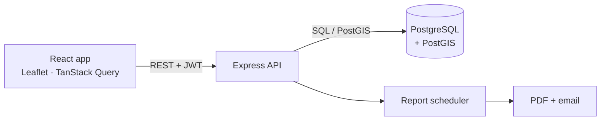

# 🚛 VComm: Fleet Safety Analytics Platform

A full-stack dashboard for fleet managers and safety officers. It turns telematics trips and safety events into driving-safety scores, interactive maps, heatmaps, and scheduled PDF reports. The backend is built on **PostgreSQL + PostGIS** so that heavy geographic filtering and aggregation happen in the database, not in the browser.

> **Portfolio copy of a team project.** Built by a team of about twenty developers during a practicum at VComm. Credentials and seed users were removed from this copy; all secrets must be supplied through environment variables. See [My contribution](#my-contribution).


## Features

- **Multi-tenant access:** every user belongs to a company and sees only that company's data, with role-based permissions (RBAC) and an admin "view as company" mode
- **Aggregated dashboard:** safety scores, distances, and event breakdowns by date range, driver, or vehicle
- **Interactive map:** heatmap, clustering, trip routes, and event points that reload by zoom level and map bounds
- **Trip summary and periodic safety pages:** drill into a single trip and its safety events
- **Violations:** configurable violation types with summaries
- **Notifications and real-time alerts:** in-app notification bell fed by database events
- **Scheduled reports:** subscribe to periodic PDF reports delivered by email
- **CSV export**
- **Admin area:** companies and users management, registration, password change
- **Integration tests:** Jest tests for auth, admin, drives, heatmap, aggregations, lookups, and map events

## Architecture



| Layer | Technologies |
|---|---|
| **Backend** | Node.js, Express, PostgreSQL + PostGIS, Zod validation, bcrypt, JWT, Jest |
| **Frontend** | React, Leaflet, TanStack Query, React Router |

Spatial and aggregation work is done in SQL: `GEOMETRY` columns with GIST indexes, bounding-box queries, and materialized views for daily and weekly aggregates keep the dashboard fast.

## Getting Started

**Requirements:** Node.js 18+, PostgreSQL with the PostGIS extension

### 1. Database

Create a database and run the migrations in order (`001` to `007`):

```bash
psql -U postgres -c "CREATE DATABASE vcomm"
psql -U postgres -d vcomm -f backend/migrations/001_initial.sql
```

Repeat the second command for each file in `backend/migrations/`. The first migration creates three demo companies. No users are seeded, so register the first user from the registration page.

### 2. Backend

```bash
cd backend
npm install
cp .env.example .env     # Windows: copy .env.example .env
```

Edit `.env` and set a real `POSTGRES_PASSWORD` and `JWT_SECRET`, then:

```bash
npm start
```

The API runs on `http://localhost:8000`.

### 3. Frontend

```bash
cd frontend
npm install
cp .env.example .env
npm start
```

Open `http://localhost:3000`.

### Tests

```bash
cd backend
npm test
```

## Project Structure

```text
vcomm/
├── backend/
│   ├── migrations/      # SQL schema, views, notifications, subscriptions
│   ├── src/
│   │   ├── routers/     # auth, admin, drives, events, heatmap, aggregations, reports...
│   │   ├── middleware/  # auth, RBAC, validation, company resolution
│   │   ├── queries/     # SQL files (PostGIS queries)
│   │   ├── services/    # PDF, email, reports
│   │   └── modules/     # report scheduler
│   └── tests/           # Jest integration tests
├── frontend/src/
│   ├── pages/           # dashboard, trip summary, reports, admin
│   ├── components/      # maps, filters, metrics, notifications, violations
│   ├── context/ hooks/ api/ utils/
└── docs/                # original product requirements and architecture guide
```

The original product requirements and architecture guide is in [`docs/ARCHITECTURE.md`](docs/ARCHITECTURE.md).

## My contribution

I worked on this project as part of a team. My parts:

- **Database foundation:** PostgreSQL + PostGIS schema and migrations (companies, users, drives with route geometry, safety events), built together with a teammate.
- **Geospatial queries:** PostGIS bounding-box filtering and grid snapping so the map loads only relevant data.
- **Google Street View integration:** a Street View link for safety events with a loading state, a disabled state when there is no coverage, coordinate validation, and server-side caching.
- **Traffic-sign detection pipeline** (separate repository): [TrafficSigns](https://github.com/t0556746399-a11y/TrafficSigns).

All other modules were developed by the rest of the team.

## Author

[@t0556746399-a11y](https://github.com/t0556746399-a11y). More projects are on my [GitHub profile](https://github.com/t0556746399-a11y?tab=repositories).
